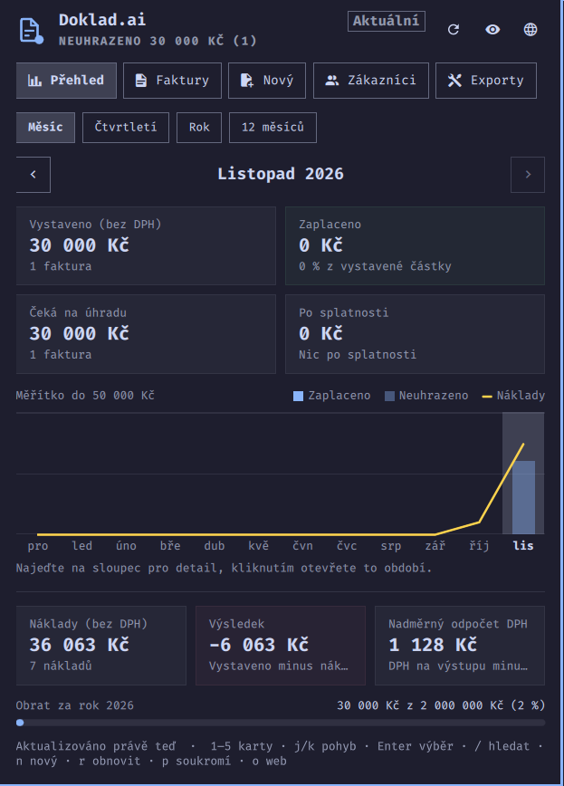

# Doklad.ai — Omarchy bar plugin

Přehledy fakturací, DPH a cashflow přímo v liště Omarchy. Plugin mluví **česky** a **slovensky** (slovenština při jazyku shellu `sk`, jinak čeština).



## Instalace

Z GitHubu (Omarchy):

```bash
omarchy plugin add https://github.com/Morganczech/omarchy-doklad-ai --enable
# nebo po klonu:
./install.sh
```

Ručně z tohoto adresáře:

```bash
./install.sh
# případně: mkdir -p ~/.config/omarchy/plugins && rsync -a ./ ~/.config/omarchy/plugins/gruut.doklad-ai/
```

Widget `Doklad.ai` patří do baru. Plugin **neinstalujte** do `/usr/share/omarchy/` — to je jen pro systémové komponenty.

Primárně pro uživatele [Doklad.ai](https://doklad.ai) v ČR (české DPH, ARES, Pohoda/Money S3). UI je česky a slovensky.

## API klíč

```bash
./setup-env.sh
```

Klíče se ukládají do `~/.config/omarchy-doklad-ai/env` (adresář `0700`, soubor `0600`). Nikdy se neobjeví v argumentech procesu, v QML ani v `shell.json`.

Export do `~/.config/environment.d/` je **volitelný a ve výchozím stavu vypnutý** — zpřístupnil by klíč všem programům v sezení.

## Co umí

- Přehled: měsíc / kvartál / rok / 12 měsíců, YoY, DPH, obrat za kalendářní rok vůči limitu
- Faktury: filtry, detail, platba, e-mail, stav, PDF, smazání konceptu
- Nový doklad: faktura (výchozí **koncept**) a náklad; před zápisem potvrzení s přesnými částkami
- Zákazníci: ARES (CZ) / RPO (SK) podle IČO
- Exporty: CSV, ISDOC, Pohoda, Money S3, ZIP s PDF
- Volitelný Zero-Data webhook relay (Cloudflare Worker) — předává jen typ události a ID

Každá zapisující akce vyžaduje `ConfirmDialog`. Živé API sandbox nemá.

## Webhook relay (volitelné)

```bash
cd webhook-relay
./relay-setup.sh deploy          # nasadí Worker, uloží RELAY_URL + TOKEN
# v panelu → Exporty → „Zaregistrovat webhook“
./relay-setup.sh secret          # nahraje whsec_… do Cloudflare
./relay-setup.sh status
```

Build běží v `~/.cache/…` (npm symlinky by jinak shodily `omarchy plugin validate`).

## Klávesy a IPC

| Klávesa | Akce |
|---------|------|
| `1`–`5` | Karty |
| `j`/`k` | Kurzor |
| Enter | Aktivovat |
| `/` | Hledat |
| `n` | Nový doklad |
| `r` | Obnovit |
| `p` | Skrýt částky |
| `o` | Otevřít Doklad.ai |

```bash
omarchy-shell gruut.doklad-ai toggle
omarchy-shell gruut.doklad-ai refresh
omarchy-shell gruut.doklad-ai togglePrivacy
omarchy-shell gruut.doklad-ai status
```

## Testy

```bash
/usr/bin/python3 -I -B -m unittest discover -s tests
node --test tests/model.test.mjs
(cd webhook-relay && npm test)   # po npm install v cache / lokálně
omarchy plugin validate .
```

## Bezpečnost

- API klíč, `whsec_…` a relay token jen v privátním `env`
- Relay neukládá jména, částky ani čísla faktur
- Soubory exportů do `~/Downloads/Doklad.ai` (jen pro vás)
- Privacy Mode skryje částky v UI i v notifikacích
